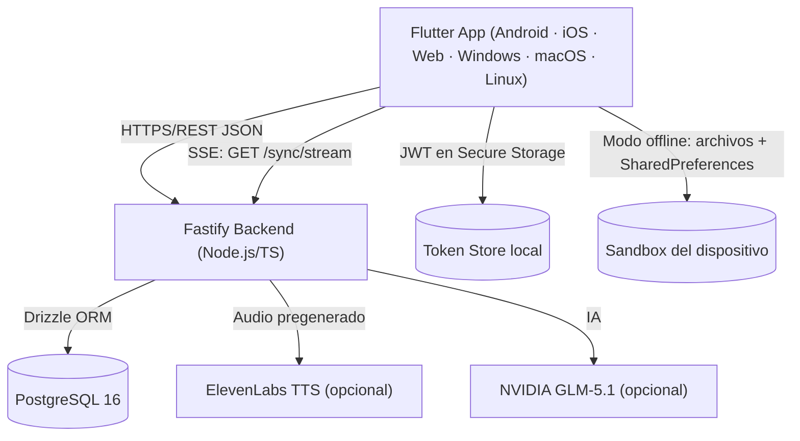

# Arquitectura de LectorSync

*Última actualización: 2026-07-16*

## Vista de alto nivel

La app funciona en **dos modos** según el flag compile-time `OFFLINE_MODE`:

- **Offline (default actual)**: sin backend. Biblioteca, lectura y TTS de dispositivo funcionan solo con almacenamiento local.
- **Conectado**: contra el backend Fastify + PostgreSQL, con sincronización de progreso en tiempo real vía SSE.

## Capas

Clean Architecture a ambos lados. Frontend: `domain → data → presentation` por feature (`auth`, `library`, `reader`, `settings`) sobre `lib/core/`. Backend: HTTP (`api/v1/routes.ts`) → lógica (`core/`) → datos (`db/`, Drizzle). El HTTP nunca toca la DB directamente.

## Flujo: autenticación (modo conectado)

1. `LoginPage`/`RegisterPage` disparan `AuthCubit.login()`.
2. `AuthCubit` → `RemoteAuthRepository.login()` → `POST /api/v1/auth/login` vía `ApiClient` (Dio).
3. El backend verifica con `scrypt` + `timingSafeEqual` y emite access (15 min) + refresh (30 días).
4. El interceptor de Dio guarda los tokens en `SecureStorage`; en un 401 intenta refresh automático.
5. `AuthCubit` emite `Authenticated`; `go_router` redirige a `/library`.

En **modo offline**, `LocalAuthRepository` acepta cualquier credencial no vacía y no hay tokens.

## Flujo: lectura con TTS sincronizado

1. `ReaderBloc` carga el capítulo (backend o `LocalReaderRepository`).
2. Al reproducir, `TtsRepositoryProxy` delega en `DeviceTtsRepository` (nativo) o `AudioTtsRepository` (audio ElevenLabs).
3. En plataformas con word-boundary nativo (Android/iOS) el highlight sigue los eventos del engine.
4. En Web/Desktop (sin word-boundary fiable) el `SegmentProgressTracker` estima el índice de palabra, calibrado por `(plataforma, voz)`, segmentando por oración para no acumular drift.
5. El progreso se persiste (`PUT /api/v1/books/:bookId/progress`) con debounce + force-sync cada 15 s + guardado al backgrounding.

## Flujo: sincronización multi-dispositivo (WIP en `desarrollo`)

1. El dispositivo A guarda progreso → el backend publica el evento en `realtimeBus`, etiquetado con el `X-Client-Id` de A.
2. Los dispositivos suscritos a `GET /api/v1/sync/stream` (SSE) reciben el evento.
3. El dispositivo A descarta su propio eco (mismo `clientId`); B lo aplica y mueve su posición de lectura.
4. Cliente Flutter: `core/sync/sync_stream_client_{io,web,stub}.dart` (selección condicional por plataforma).

## Estado por área (2026-07-16)

| Área | Estado |
|---|---|
| Auth (register/login/refresh/logout, revocación) | ✅ Completo |
| Import EPUB/PDF/TXT/MD (conectado) | ✅ Completo |
| Lectura + TTS palabra-a-palabra (Web/Windows/Android) | ✅ Verificado |
| Modo offline (PDF/TXT/MD) | ✅ Completo · EPUB offline pendiente |
| Sync multi-dispositivo SSE | 🚧 WIP en `desarrollo` |
| CI/CD | ❌ Pendiente |

Ver `.claude/docs/BACKEND-API.md` para el detalle de endpoints y `DECISIONS.md` para el porqué de cada decisión.
